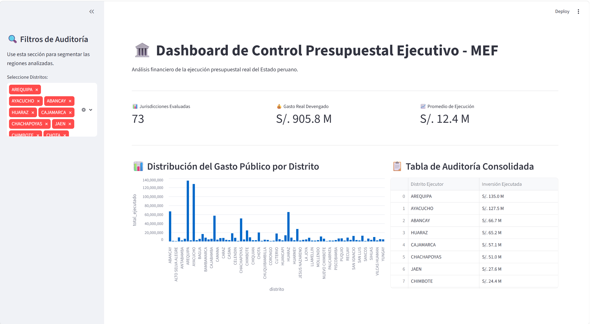

[](https://github.com/jorgearaucano06/Portafolio_RPA_Data/actions/workflows/ci.yml)

# Plataforma de Ingesta, Control Presupuestal y ML — MEF Peru

Pipeline end-to-end de **Data Engineering, Machine Learning y Business Intelligence**
sobre datos reales de ejecucion presupuestal del Ministerio de Economia y Finanzas (MEF).

Cubre el ciclo completo: ingesta masiva por HTTP, procesamiento distribuido con Spark,
filtros de calidad, modelos predictivos (regresion + clustering), dashboard interactivo
y replica del pipeline en Databricks (nube).

---

## Que hace este proyecto

1. **Descarga datos reales** del portal de datos abiertos del MEF (CSV de ~8 GB, +100k filas procesadas)
2. **Filtra y limpia** con reglas de calidad UAT (rechaza montos invalidos, registros incompletos)
3. **Procesa con Spark** en paralelo usando todos los cores disponibles
4. **Persiste en Parquet** particionado por anio y departamento
5. **Analiza** con estadisticas descriptivas, correlaciones y deteccion de outliers
6. **Entrena modelos ML** para predecir gasto y agrupar jurisdicciones por patrones
7. **Visualiza** en un dashboard Streamlit con metricas descriptivas y predictivas
8. **Replica en Databricks** con pipeline completo en la nube (ingesta automatica, capas Bronze/Silver/Gold, EDA, ML)

---

## Estructura del proyecto

```
Portafolio_RPA_Data/
├── config/                         # Configuracion centralizada
│   ├── settings.py                 # Dataclasses inmutables (toda la config)
│   ├── spark_config.py             # Factory de SparkSession
│   └── logging_config.py           # Logging profesional (stdlib)
│
├── src/
│   ├── excepciones.py              # PipelineError, DescargaError, CalidadError
│   ├── pipeline.py                 # Runner de etapas con metricas
│   ├── verificar_spark.py          # Verificacion del entorno (Fase 0)
│   ├── spark_conceptos.py          # Demo de conceptos Spark (Fase 1)
│   │
│   ├── ingesta/                    # Descarga HTTP + lectura CSV con schema
│   ├── calidad/                    # Filtros UAT + tracking de metricas
│   ├── agregacion/                 # groupBy/agg + escritor Parquet
│   └── ml/                         # Feature engineering, sklearn, MLlib
│
├── notebooks/
│   ├── 01_eda.ipynb                # Analisis exploratorio completo
│   └── 02_ml_sklearn.ipynb         # Regresion + clustering con scikit-learn
│
├── tests/                          # 30 tests pytest (calidad, agregacion, features)
│   ├── conftest.py                 # Fixtures: SparkSession, DataFrames de ejemplo
│   └── data/sample_gasto.csv       # 50 filas con edge cases
│
├── rpa_ingesta.py                  # v1 — Pipeline original (referencia)
├── app_dashboard.py                # v1 — Dashboard original (referencia)
├── app_dashboard_v2.py             # v2 — Dashboard con 4 secciones
└── requirements.txt
```

---

## Tecnologias

| Capa | v1 | v2 |
|------|----|----|
| Procesamiento | Python fila a fila (1 core) | PySpark 4.1.2 (32 cores) |
| Almacenamiento | SQLite | Parquet particionado + Delta Lake |
| Logging | print() | stdlib logging |
| Tests | Ninguno | pytest (30 tests) |
| ML | Ninguno | scikit-learn + PySpark MLlib |
| Dashboard | KPIs basicos | Descriptivo + Predictivo + Clustering |
| Config | Hardcodeada | Dataclasses frozen + .env |
| Nube | Ninguno | Databricks Free Edition |

**Stack**: Python 3.14, PySpark 4.1.2, JDK 17 (Temurin), scikit-learn, pandas,
Streamlit, matplotlib, seaborn, Databricks, Delta Lake.

---

## Como ejecutar

```bash
# 1. Clonar y crear entorno
git clone https://github.com/tu-usuario/Portafolio_RPA_Data.git
cd Portafolio_RPA_Data
python -m venv .venv
.venv\Scripts\activate        # Windows
pip install -r requirements.txt

# 2. Verificar que Spark funciona
python -m src.verificar_spark

# 3. Correr los tests
python -m pytest tests/ -v

# 4. Explorar conceptos de Spark
python -m src.spark_conceptos

# 5. Dashboard v2
streamlit run app_dashboard_v2.py
```

**Requisitos previos**: JDK 17 instalado, `JAVA_HOME` configurado.
En Windows: `winutils.exe` + `hadoop.dll` en `C:\hadoop\bin\`.
Ver `.env.example` para las variables de entorno.

---

## Modelos de ML

### Regresion (predecir monto de ejecucion)
- Linear Regression
- Random Forest Regressor
- Gradient Boosting Regressor
- Metricas: RMSE, MAE, R2
- Validacion: cross-validation (k=5), train/test split 80/20

### Clustering (agrupar jurisdicciones)
- K-Means con Elbow Method
- DBSCAN
- Metrica: Silhouette Score
- Visualizacion 2D con PCA

### Pipeline MLlib (ML distribuido)
- StringIndexer -> OneHotEncoder -> VectorAssembler -> Modelo
- Comparativa sklearn vs MLlib

---

## Tests

```
tests/test_calidad.py      — 9 tests  (filtros UAT: monto, distrito, umbral)
tests/test_agregacion.py   — 11 tests (groupBy, sumas, SQL vs API)
tests/test_features.py     — 10 tests (encoding, clustering, shapes)
                             ─────────
                             30 tests, todos pasando
```

---

## Fases del roadmap

| Fase | Contenido | Estado |
|------|-----------|--------|
| 0 | Setup JDK 17, PySpark 4.1.2, winutils | Completada |
| 1 | Conceptos Spark: lazy eval, explain, cache, particiones | Completada |
| 2 | Ingesta HTTP + lectura CSV con schema explicito | Completada |
| 3 | Filtros de calidad UAT en Spark + tests | Completada |
| 4 | Agregaciones (DataFrame API + SQL) + Parquet particionado | Completada |
| 5 | EDA: estadisticas, distribuciones, correlacion, outliers | Completada |
| 6 | ML con scikit-learn: regresion + clustering | Completada |
| 7 | ML distribuido con PySpark MLlib | Completada |
| 8 | Replica en Databricks Free Edition (5 notebooks, 6 tablas Delta) | Completada |
| 9 | Dashboard avanzado (descriptivo + predictivo + clustering) | Completada |
| 10 | Documentacion final + merge a main | Completada |

Detalle completo: [`docs/plan_v2.md`](docs/plan_v2.md) |
Progreso: [`docs/checklist.md`](docs/checklist.md)

---

## Databricks (nube)

El pipeline completo se replico en Databricks Free Edition con 5 notebooks y arquitectura de Data Lake:

| Notebook | Que hace |
|----------|----------|
| `00_verificacion` | Lectura de tablas, filtros, agregaciones, Spark SQL |
| `01_ingesta_automatica` | Descarga automatica desde API del MEF (100,000 filas) |
| `02_calidad_y_agregaciones` | Filtros UAT + agregaciones por departamento y sector |
| `03_eda` | Estadisticas descriptivas, distribuciones, outliers, graficos |
| `04_machine_learning` | Regresion (3 modelos) + clustering K-Means (15 departamentos) |

### Capas del Data Lake

```
Bronze (gasto_mef_muestra)         → datos crudos, todo string
Silver (gasto_mef_tipado)          → tipos correctos (int, double, string)
Silver+ (gasto_mef_validos)        → solo registros que pasan filtro UAT
Gold (gold_gasto_por_departamento) → agregacion lista para negocio
Gold (gold_gasto_por_sector)       → agregacion lista para negocio
```

---

## v1 (referencia)

La v1 sigue intacta en `rpa_ingesta.py` y `app_dashboard.py`. Procesa una muestra
de 40 MB (~29,050 registros limpios) con Python + SQLite en un solo core.
Sirve como benchmark para comparar con v2.


